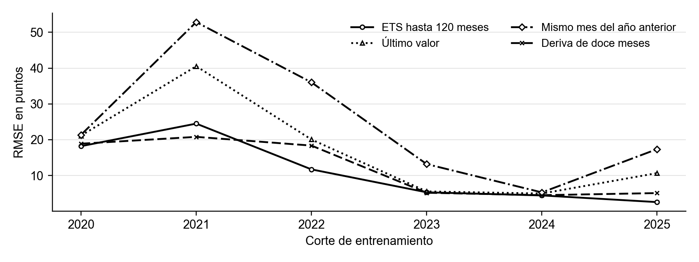
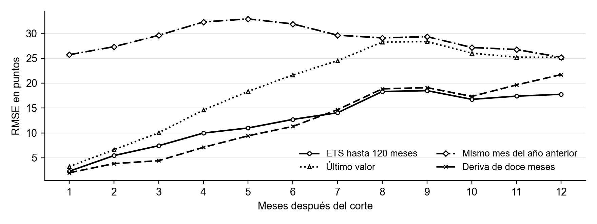
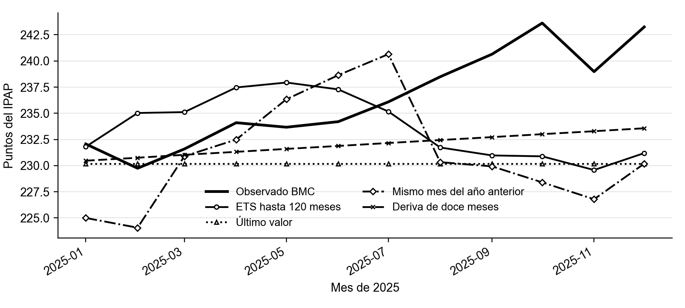
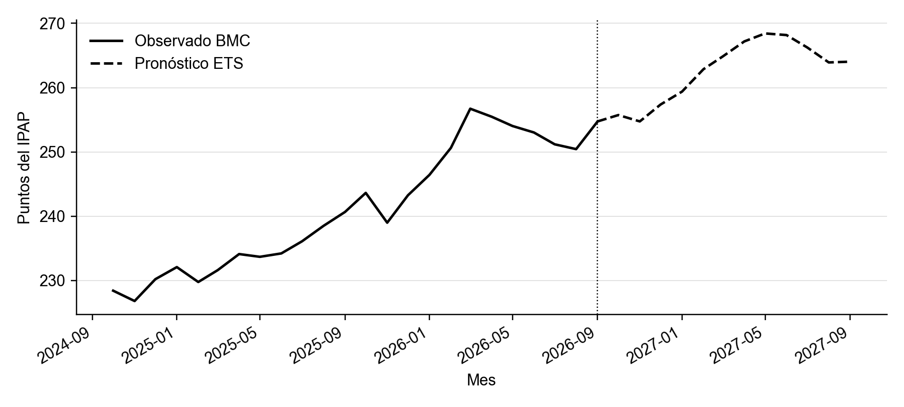

# Resultados del pronóstico IPAP BMC

ETS usa hasta 120 meses anteriores a cada corte y pronostica doce meses sin recibir datos reales intermedios. El CSV oficial conserva sus 189 meses completos.

## Evaluación histórica

Los seis cortes de septiembre de 2020 a septiembre de 2025 generan 72 predicciones por método, de octubre de 2020 a septiembre de 2026.

| modelo | RMSE | MAE | MAPE | n |
| --- | --- | --- | --- | --- |
| ETS_120_meses | 13.68 | 9.50 | 4.61 | 72 |
| Naive | 21.06 | 14.92 | 6.99 | 72 |
| Naive12 | 29.01 | 22.01 | 10.30 | 72 |
| Deriva12 | 14.14 | 9.91 | 4.76 | 72 |

RMSE y MAE están en puntos del índice. MAPE está en porcentaje. ETS reduce el RMSE 35.05% frente a repetir el último valor. La ventana de hasta 120 meses se definió durante el desarrollo. Los períodos evaluados ya se examinaron, por lo que estos resultados son retrospectivos y no una nueva validación independiente.

## Ejemplo de 2025

Se entrena hasta diciembre de 2024 y se pronostica enero a diciembre de 2025. Este ejercicio comparte meses con los seis cortes y no es otra prueba independiente.

| modelo | RMSE | MAE | MAPE | n |
| --- | --- | --- | --- | --- |
| ETS_120_meses | 7.16 | 5.94 | 2.49 | 12 |
| Naive | 7.59 | 6.25 | 2.61 | 12 |
| Naive12 | 8.49 | 7.17 | 3.01 | 12 |
| Deriva12 | 5.59 | 4.52 | 1.89 | 12 |

## Pronóstico final

El modelo guardado se ajustó con 120 meses, de 2016-10 a 2026-09. Los doce valores futuros están en pronostico_12_meses.csv. Son estimaciones del modelo, no observaciones oficiales ni precios en pesos. No hay intervalos calibrados en esta entrega.

La captura BMC puede incorporar revisiones y no permite recuperar todas las versiones históricas. Se conservaron los niveles publicados sin imputar ni reescalar. El nivel 99,13 de diciembre de 2014 sigue pendiente de aclaración frente a la base declarada por el productor.
